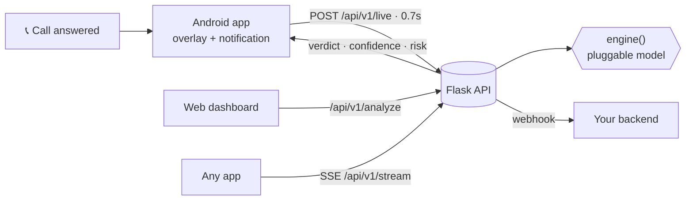

<div align="center">

# 🛡️ VoiceSuraksha.Ai

### Is that really your voice on the line?
**Live Human-vs-AI voice verdict on every call, built for the era of voice-clone scams.**

☕ Built by **Team Coffee Break**


</div>

---

## 🚨 Why this matters

AI voice cloning needs only seconds of audio. Scammers now fake a relative's voice, a bank officer or a "police" caller, and the victim has seconds to decide under pressure.
Today's call apps flag **numbers**. Nobody checks the **voice**.

**VoiceSuraksha.Ai puts a live Human / AI verdict on the call screen while the call is happening.**

## ✨ What we built

| | |
|---|---|
| 📱 **Android app** | Wakes on a call, shows a live verdict **over the call screen** and on the **lock screen**, starts when you answer, stops when the call ends from either side. |
| ⚙️ **Detection API** | REST, live polling, SSE stream, webhooks, optional API key, CORS. One endpoint to swap the model. |
| 🖥️ **Web dashboard** | Upload audio/video, record, live mic visualization, scan history, Hindi / English UI. |
| 🚨 **Scam alert** | Vibration and warning when AI-voice risk turns high. |

Thin-client design: the app only *fetches*. Upgrade the model on the server and every app improves instantly.

## 🏗️ Architecture



## 🔌 API

| Method | Endpoint | Description |
| --- | --- | --- |
| `GET` | `/api/v1/health` | Service health check |
| `POST` | `/api/v1/analyze` | Analyze an uploaded file |
| `POST` | `/api/v1/live` | Rolling live result during a call |
| `GET` | `/api/v1/stream` | Continuous results via Server-Sent Events |
| `GET` | `/api/v1/call` | Current call context |
| `GET` | `/api/v1/history` | Recent results |

```json
{ "verdict": "ai", "ai_prob": 93.4, "confidence": 93.4, "risk": "high",
  "metrics": { "spectral": 88.1, "vocoder": 90.2, "prosody": 14.7, "breath": 11.3 } }
```

Full docs at `/docs`. Set `API_KEY` to require an `X-API-Key` header, and `WEBHOOK_URL` to receive results.

## 🚀 Quick start

**Server** (Python 3.10+)
```bash
python -m venv .venv          # then activate it
pip install -r requirements.txt
python app.py                 # http://localhost:5000
```
To reach it from a phone: `ngrok http 5000`. Microphone features need localhost or HTTPS.

**Android** (`VoiceSurakshaAndroid/`)
1. Open in Android Studio (JDK 17, Gradle 8.7), add `kotlin.compiler.execution.strategy=in-process` to `gradle.properties`.
2. Run on a phone, grant **Display over other apps** and **Phone state**.
3. Enter the server URL and tap **Check server connection**.

## 🎬 Watch it in action

> 📹 **Video:** _add link here_
> 📸 **Android screenshots:** _add `android-overlay.png` here_
> **Live demo :** https://choking-justify-plot.ngrok-free.dev/
## 🧪 Honest status

The product experience is real end to end: Android call lifecycle, overlay, lock-screen notification, API, streaming and dashboard.
The scoring function `engine()` in `app.py` is currently a **placeholder that returns simulated results** and does not analyze audio content. It is the single integration point, so a validated model drops in with no change to the apps or API.
The operator control page is a prototype feature without authentication, so keep it off public deployments.

## 🗺️ Roadmap

1. **Real model in `engine()`**: anti-spoofing networks such as AASIST / RawNet2 / wav2vec2 trained on ASVspoof-style data.
2. **Real call-audio path**: Android limits third-party access to call audio. Options: default-dialer role, speakerphone capture, operator-side integration.
3. **On-device inference** (TFLite / ONNX) for privacy and offline use.
4. **Family safe-word** and trusted-contact verification.
5. **Regional-language** models and UI.
6. **One-tap reporting** to the cyber-crime helpline.

## 🔒 Privacy

Audio is never stored by the app. The server keeps only the last 50 results in memory.

## 👤 Team

**☕ Team Coffee Break**

## 📜 License

MIT
