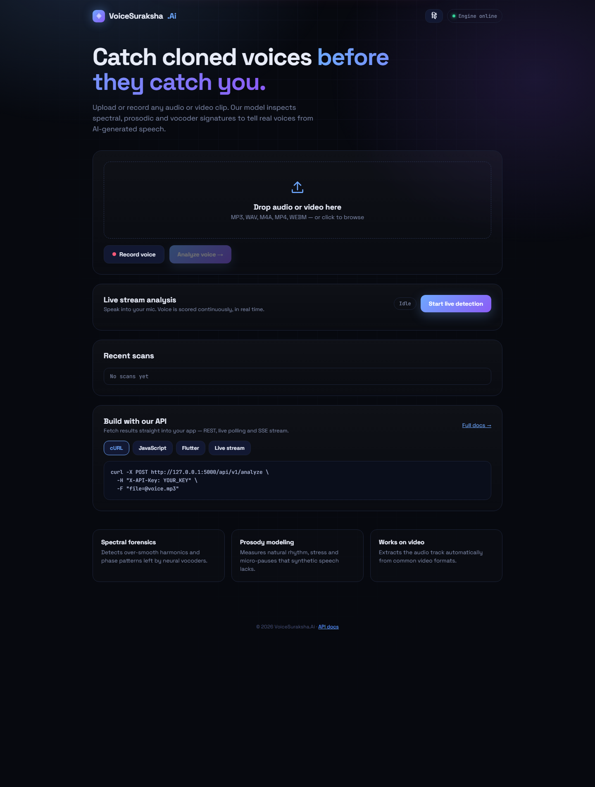

# VoiceSuraksha.Ai

A web demo for exploring synthetic-voice detection workflows. The interface includes audio/video upload, microphone recording, live microphone visualization, recent scans, and API examples.

## Website



## Video demo

> **Coming soon:** Add a public link to the project demo video here.

## Run locally

Requires Python 3.10 or later.

```bash
python -m venv .venv
```

Activate the virtual environment, then install dependencies and start the app:

```bash
pip install -r requirements.txt
python app.py
```

Open [http://127.0.0.1:5000](http://127.0.0.1:5000) in your browser. Microphone features require browser permission and are generally available on localhost or HTTPS.

## API

The API documentation is available at `/docs` while the app is running. The main endpoints are:

| Method | Endpoint | Description |
| --- | --- | --- |
| `GET` | `/api/v1/health` | Service health check |
| `POST` | `/api/v1/analyze` | Return an analysis result |
| `POST` | `/api/v1/live` | Return a rolling live result |
| `GET` | `/api/v1/stream` | Stream results using Server-Sent Events |
| `GET` | `/api/v1/history` | Return recent results |

Set `API_KEY` to require an `X-API-Key` header for `/api/v1` endpoints. `WEBHOOK_URL` can be set to receive analysis-result webhooks.

## Demo limitations

The current scoring engine is a placeholder that generates simulated results; it does not analyze the contents of uploaded audio. Replace `engine()` in `app.py` with a real, validated model before using results to make decisions.

The control page is a demo feature, not an authenticated administration interface. Do not expose it on a public deployment without adding proper access control.
